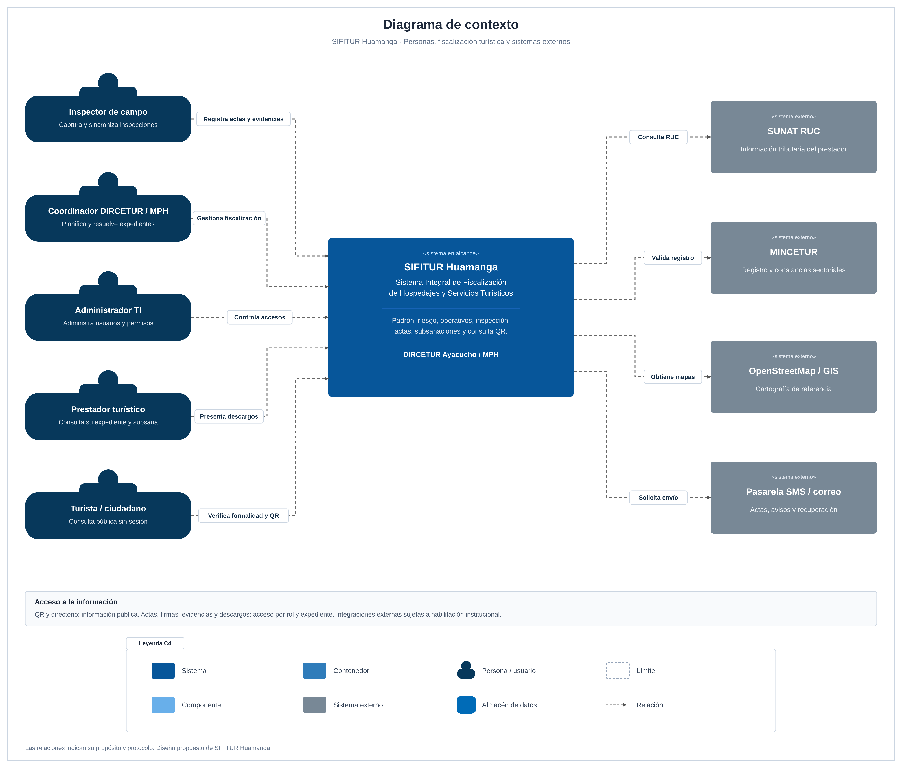

# SIFITUR Huamanga · Entregable 02

## Nombre

Jean Pool Kenner Palomino Mavila

## Descripción

Sistema Integral de Fiscalización de Hospedajes y Servicios Turísticos en Huamanga. Integra empadronamiento, control documental, planificación de operativos, inspección móvil offline, custodia de evidencias, emisión de actas, seguimiento de subsanaciones y consulta pública de formalidad mediante QR.

## Caso de estudio

Fiscalización turística de DIRCETUR Ayacucho y la Municipalidad Provincial de Huamanga.

## Curso

Arquitectura de Software · IS-488 · Universidad Nacional de San Cristóbal de Huamanga · 2026-II.

## Estructura

```text
docs/
├── 01-analisis-de-sistema/
├── 02-arquitectura-software/
├── 03-diseño-de-software/diseño-interno/
└── 04-modelo-c4/
img/
└── fuentes-svg/
```

## Documentación

| Bloque | Archivos |
|---|---|
| Análisis | [Necesidad](docs/01-analisis-de-sistema/00-necesidad-del-negocio.md), [actores](docs/01-analisis-de-sistema/01-actores.md), [historias](docs/01-analisis-de-sistema/02-historias-del-usuario.md), [requisitos](docs/01-analisis-de-sistema/03-requisitos-funcionales.md). |
| Calidad y decisiones | [Atributos](docs/01-analisis-de-sistema/04-atributos-de-calidad.md), [restricciones](docs/01-analisis-de-sistema/05-restricciones.md), [drivers](docs/01-analisis-de-sistema/06-driver-arquitectonicos.md), [decisiones](docs/01-analisis-de-sistema/07-decisiones-arquitectonicas.md), [escenarios](docs/01-analisis-de-sistema/08-escenarios-atributos-calidad.md). |
| Arquitectura | [Inicial](docs/02-arquitectura-software/arquitectura-inicial.md), [componentes](docs/02-arquitectura-software/componentes-arquitectonicos.md), [enfoque](docs/02-arquitectura-software/enfoque-arquitectonico.md), [estilo](docs/02-arquitectura-software/estilo-arquitectonico.md). |
| Diseño | [Diseño interno](docs/03-diseño-de-software/diseño-interno/diseño-interno-de-modulos.md), [patrones](docs/03-diseño-de-software/diseño-interno/patrones-de-diseño.md), [SOLID](docs/03-diseño-de-software/diseño-interno/principios-de-diseño.md). |
| C4 | [Contexto](docs/04-modelo-c4/Nivel1-DiagramadeContextodelSistema.md), [contenedores](docs/04-modelo-c4/Nivel2-DiagramadeContenedores.md), [componentes](docs/04-modelo-c4/Nivel3-Diagrama-de-Componentes.md), [código](docs/04-modelo-c4/Nivel4-DiagramadeCodigo.md). |

## Arquitectura

Backend monolítico modular Node.js/NestJS con Clean Architecture. App Flutter con SQLite cifrada, consola y portal del administrado React, portal público Next.js, PostgreSQL primaria y réplica, Redis, S3 y RabbitMQ. Las integraciones externas son SUNAT, MINCETUR, OpenStreetMap y pasarela SMS/correo.



## Convenciones de lectura

La documentación especifica la arquitectura propuesta de SIFITUR Huamanga. Los RF, AC, DA, ADR y EQ enlazan requisitos, calidad, drivers, decisiones y escenarios de aceptación. Las métricas son objetivos de diseño; la validación de una aplicación desplegada corresponde a la etapa de implementación.

Los diagramas se publican en PNG para lectura y en [SVG editable](img/fuentes-svg/) para ampliación sin pérdida. Cada vista identifica su alcance, fronteras y leyenda. El proceso se desarrolla en el análisis; C4 permite navegar de personas y sistemas a contenedores, componentes y clases; el diseño interno detalla sincronización, emisión y estados del expediente.

Base documental: Propuesta SIFITUR Huamanga; GUIA-004-ASF, laboratorio IS-488; estructura del [repositorio modelo](https://github.com/devlizbethjaico/Marketplace-arquitSoft-02). El alcance de esta entrega comprende documentación y diagramas.
