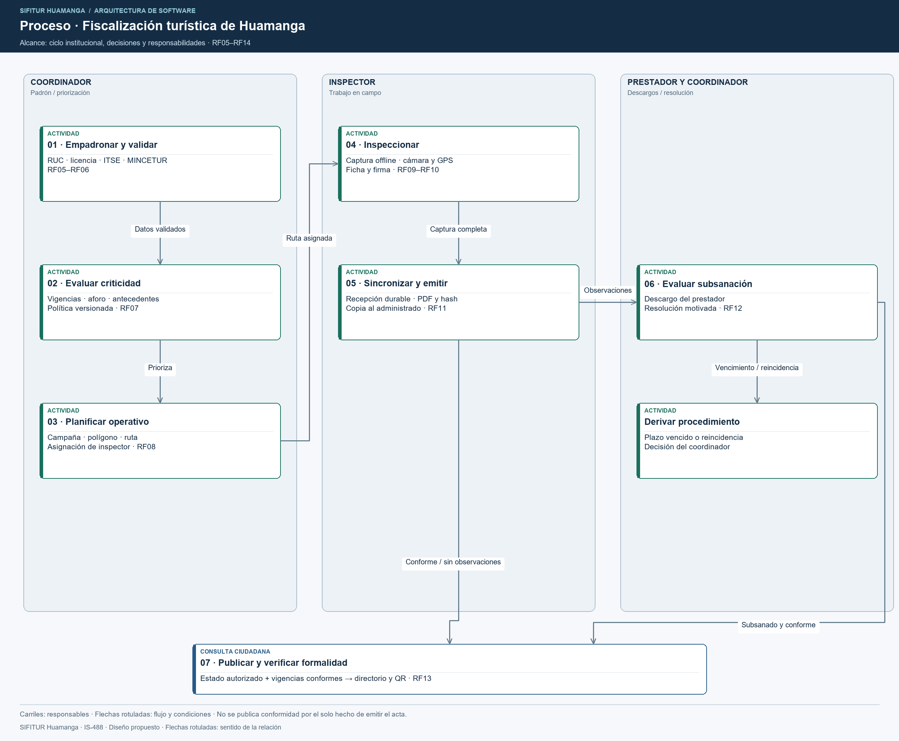

# Necesidad del negocio de SIFITUR Huamanga

## Problema y contexto

La fiscalización de hospedajes y servicios turísticos de Huamanga articula el padrón de prestadores, las visitas en campo, el control documental y el seguimiento de subsanaciones entre DIRCETUR Ayacucho y la Municipalidad Provincial de Huamanga. El registro manual en papel dificulta mantener expedientes y evidencias trazables durante todo el proceso.

SIFITUR Huamanga integra aplicaciones móviles y web para registrar inspecciones incluso sin conectividad, gestionar los expedientes y permitir la consulta pública de formalidad mediante códigos QR.

## Objetivos del negocio

| ID | Objetivo | Requisitos relacionados |
|---|---|---|
| ON01 | Consolidar el padrón y controlar las vigencias documentales. | RF05, RF06 |
| ON02 | Priorizar establecimientos y coordinar operativos territoriales. | RF07, RF08, RF14 |
| ON03 | Registrar inspecciones, firmas y fotografías sin interrumpir el trabajo por falta de red. | RF03, RF09, RF10, RF11 |
| ON04 | Evaluar descargos y dar seguimiento a los plazos de subsanación. | RF12 |
| ON05 | Permitir la verificación ciudadana de servicios formales. | RF13 |
| ON06 | Controlar accesos y registrar acciones sensibles. | RF01, RF02, RF04, RF15 |

## Alcance del proceso

El proceso comprende empadronamiento, evaluación de riesgo, programación de operativos, inspección en campo, seguimiento de subsanaciones y publicación de formalidad. Los expedientes con observaciones mantienen su seguimiento hasta la subsanación o derivación al procedimiento sancionador.

## Usuarios y demanda

| Perfil | Usuarios registrados | Concurrencia promedio | Pico previsto | Canal |
|---|---|---|---|---|
| Inspector de campo | 35 | 15 | 35 concurrentes | App móvil Flutter |
| Coordinador de fiscalización | 12 | 6 | 12 concurrentes | Consola administrativa React |
| Administrador TI | 4 | 2 | 4 concurrentes | Consola administrativa React |
| Prestador turístico | 600 establecimientos | 25 accesos diarios | 120 accesos diarios | Portal del administrado React |
| Turista / ciudadano | Público abierto | 400 accesos diarios | 8,000 accesos diarios; 900 solicitudes/minuto | Portal Next.js y visor QR |

La estimación considera 30,000 visitantes únicos acumulados en 4 a 6 días durante festividades y un patrón de 95 % lecturas y 5 % escrituras. La capacidad objetivo es 1,200 solicitudes por minuto. Los visitantes acumulados y los accesos diarios no representan usuarios concurrentes.
