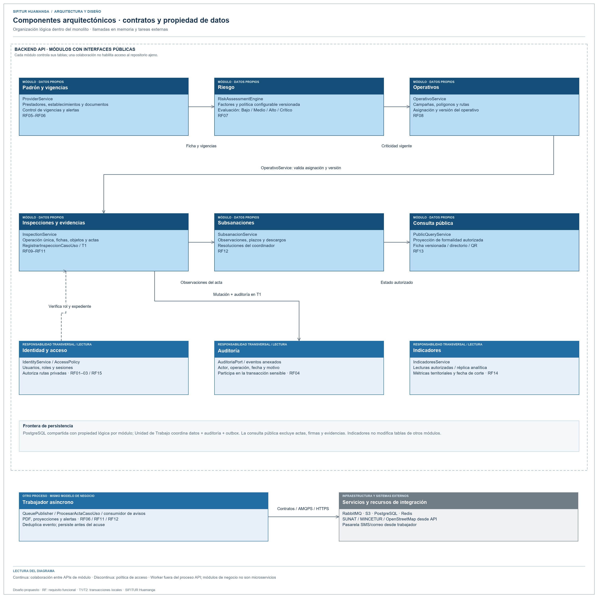

# Componentes arquitectónicos de SIFITUR Huamanga

Fuente editable: [componentes.svg](../../img/fuentes-svg/componentes.svg).

| Componente | Responsabilidad | Requisitos |
|---|---|---|
| Identidad y acceso | Usuarios, recuperación de credenciales, JWT y RBAC. | RF01, RF02, RF03, RF15 |
| Padrón y vigencias | Prestadores, documentos y alertas de vencimiento. | RF05, RF06 |
| Riesgo | Clasificación de criticidad según reglas versionadas. | RF07 |
| Operativos | Campañas, polígonos y asignación de rutas. | RF08 |
| Inspecciones y evidencias | Captura, sincronización, fotos y actas firmadas. | RF09, RF10, RF11 |
| Subsanaciones | Descargos, plazos y evaluación de observaciones. | RF12 |
| Consulta pública e indicadores | Directorio, QR, mapas y exportaciones. | RF13, RF14 |
| Auditoría | Registro de operaciones sensibles de solo anexado. | RF04 |
| Procesamiento asíncrono | Emisión del PDF, actualización de proyecciones y notificación. | RF06, RF11, RF12 |
