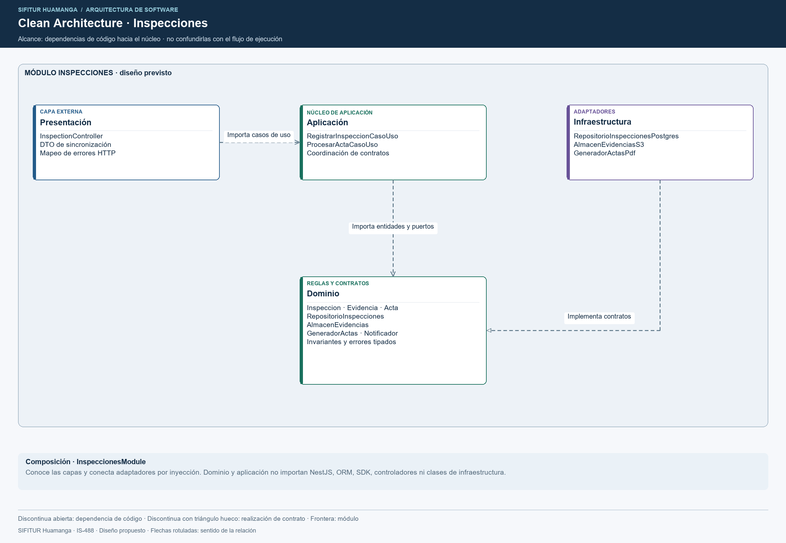

# Enfoque arquitectónico

## Clean Architecture de SIFITUR Huamanga

| Elemento | Descripción aplicada al proyecto |
|---|---|
| Enfoque | Clean Architecture dentro de cada módulo del backend. |
| Objetivo | Separar las reglas de fiscalización de frameworks, persistencia y servicios externos. |
| Problema resuelto | Evitar que las reglas de actas, vigencias, riesgo y subsanaciones dependan de NestJS, PostgreSQL, S3 o una pasarela de notificaciones. |
| Capas | Presentación, Aplicación, Dominio e Infraestructura. |
| Beneficio | Pruebas del núcleo sin framework; adaptadores intercambiables y responsabilidades explícitas. |

Fuente editable: [arquitectura-limpia-sifitur.svg](../../img/fuentes-svg/arquitectura-limpia-sifitur.svg).

## Capas y dependencias

| Capa | Contenido | Dependencias |
|---|---|---|
| Dominio | Inspeccion, Evidencia, Acta, reglas de vigencia y contratos. | Dominio y biblioteca estándar. |
| Aplicación | RegistrarInspeccionCasoUso, ProcesarActaCasoUso y coordinación de puertos. | Dominio. |
| Presentación | Controladores REST, DTO y traducción de errores HTTP. | Aplicación y dominio para tipos. |
| Infraestructura | Repositorios, objetos, generación de PDF y clientes institucionales. | Contratos del dominio y bibliotecas técnicas. |
| Composición | Módulos NestJS que seleccionan implementaciones. | Todas las capas para conectarlas. |

El dominio y los casos de uso no importan NestJS, ORM ni SDK de proveedores. Cada módulo expone una API pública; los demás módulos no acceden a sus repositorios internos. La presentación móvil conserva borradores en SQLite cifrada y sincroniza por REST; el backend revalida las reglas y permisos antes de confirmar los cambios.

## Flujo de sincronización

1. Flutter conserva ficha, firma y evidencias con un identificador de operación estable.
2. Al recuperar red se verifica la sesión y se envía el registro y sus referencias de evidencia.
3. El caso de uso comprueba autorización, idempotencia e integridad de los objetos recibidos.
4. El repositorio confirma inspección, auditoría y tarea outbox en una transacción institucional.
5. El trabajador genera y conserva el PDF, confirma el acta y registra la tarea de notificación.
6. Un reintento idéntico devuelve el mismo registro; un contenido distinto para la misma operación genera conflicto.

## Elección frente a arquitectura hexagonal

Ambos enfoques separan negocio e infraestructura mediante puertos y adaptadores. SIFITUR utiliza Clean Architecture porque la documentación distingue explícitamente entidades, coordinación de casos de uso, traducción REST e infraestructura. Los puertos permanecen en el núcleo del módulo; ningún caso de uso instancia SDK de S3, conexiones SQL o clientes HTTP.

Las dependencias de código y el flujo de ejecución son distintos: en ejecución el caso de uso llama a un puerto cuyo objeto concreto es un adaptador; en código, el adaptador depende del contrato interno. La raíz de composición es el único punto que conoce ambos.
