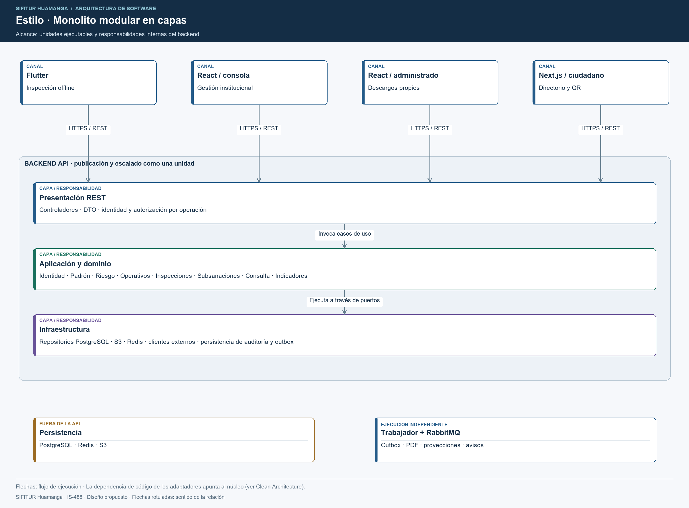

# Estilo arquitectónico

SIFITUR Huamanga utiliza un estilo **cliente-servidor multicanal con backend monolítico modular organizado en capas**. El backend Node.js/NestJS se despliega como una aplicación con módulos institucionales; sus instancias son sin estado y se replican detrás del balanceador.

Fuente editable: [arquitectura-monolitica-sifitur.svg](../../img/fuentes-svg/arquitectura-monolitica-sifitur.svg).

## Organización del sistema

| Unidad | Responsabilidad | Tecnología |
|---|---|---|
| App móvil | Captura, firma, evidencia y operación offline. | Flutter y SQLite cifrada |
| Consola administrativa | Padrón, operativos, riesgo, usuarios y evaluación de descargos. | React SPA |
| Portal del administrado | Expediente propio y presentación de subsanaciones. | React SPA |
| Portal ciudadano | Directorio público, formalidad y QR. | Next.js SSR |
| Backend modular | Casos de uso y autorización institucional. | Node.js y NestJS |
| Trabajador | Documentos, proyecciones y notificaciones. | Node.js y RabbitMQ |
| Persistencia | Datos institucionales, lectura, caché y objetos. | PostgreSQL, Redis y S3 |

## Reglas del monolito modular

1. Los módulos de negocio del backend se despliegan juntos y se comunican mediante su API pública.
2. Cada módulo mantiene propiedad lógica sobre sus tablas y repositorios.
3. Clean Architecture organiza las dependencias internas de cada módulo.
4. Las aplicaciones cliente y el trabajador tienen ejecución independiente del backend.
5. La consulta pública no requiere JWT; las operaciones privadas verifican identidad, rol y pertenencia del expediente.
6. La primaria confirma escrituras; caché y réplica atienden lecturas con políticas de actualización explícitas.
7. Las tareas asíncronas usan outbox, identificador estable, reintentos y consumidores idempotentes.

## Límites y compensaciones

El monolito modular permite transacciones locales y reduce coordinación operativa, pero sus módulos comparten el ciclo de publicación y un fallo de proceso afecta a la instancia completa. Se mitiga mediante instancias redundantes, contratos de módulo y validación de regresión. El trabajador utiliza el mismo modelo de negocio con entrada de mensajería y escala por separado; la presencia de RabbitMQ no convierte cada módulo en un microservicio.
