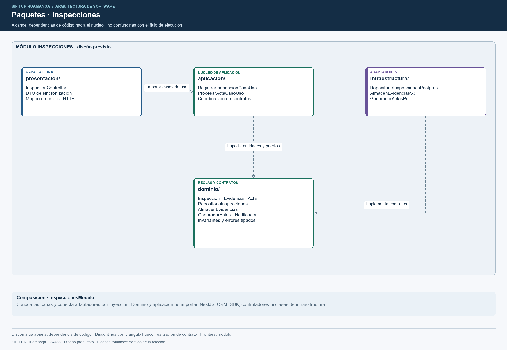
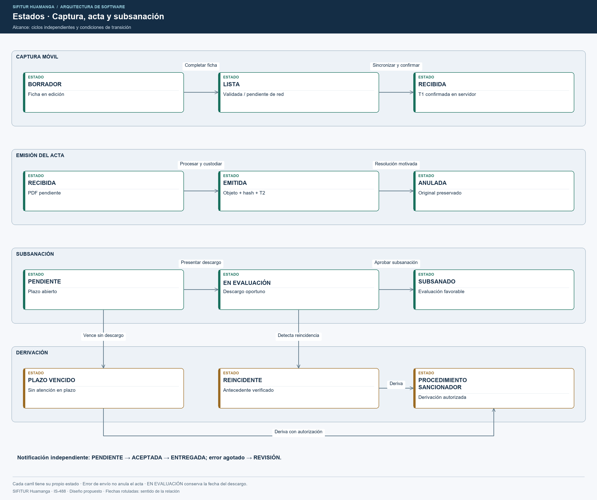

# Diseño interno de módulos

> **Proyecto:** SIFITUR Huamanga · **Backend:** Node.js + NestJS + TypeScript · **Módulo de referencia:** Inspecciones

## 1. Propósito

Definir las clases, contratos, reglas y colaboración interna para registrar una inspección sincronizada y emitir su acta PDF. El módulo responde a RF03, RF04 y RF09–RF11.

## 2. Estructura de carpetas prevista

La siguiente estructura especifica el diseño de implementación del módulo.

```text
src/modules/inspecciones/
├── dominio/
│   ├── inspeccion.ts
│   ├── evidencia.ts
│   ├── contratos.ts
│   └── errores.ts
├── aplicacion/
│   ├── registrar-inspeccion.caso-uso.ts
│   └── procesar-acta.caso-uso.ts
├── infraestructura/
│   ├── repositorio-postgres.ts
│   ├── almacen-s3.ts
│   ├── generador-actas-pdf.ts
│   └── notificador-institucional.ts
├── presentacion/
│   └── inspection.controller.ts
├── inspecciones.module.ts
└── index.ts
```

| Archivo / clase | Capa | Responsabilidad |
|---|---|---|
| Inspeccion | Dominio | Validar identidad de captura, operación, prestador, firma y evidencias. |
| Evidencia | Dominio | Validar origen cámara, GPS y hash del archivo original. |
| RepositorioInspecciones | Dominio | Registrar operación única, consulta y tareas de emisión/notificación. |
| AlmacenEvidencias | Dominio | Verificar objetos y conservar el acta emitida. |
| GeneradorActas | Dominio | Solicitar bytes del acta PDF sin conocer la biblioteca. |
| Notificador | Dominio | Solicitar entrega de la copia al correo del administrado. |
| RegistrarInspeccionCasoUso | Aplicación | Autorizar al inspector, verificar idempotencia y evidencias y registrar. |
| ProcesarActaCasoUso | Aplicación | Generar, almacenar y confirmar PDF; reintentar la notificación. |
| InspectionController | Presentación | Traducir HTTP, actor autenticado y resultado del caso de uso. |
| InspeccionesModule | Composición | Conectar contratos y adaptadores con inyección NestJS. |

## 3. Capas y regla de dependencia



Fuente editable: [paquetes-modulo-inspecciones.svg](../../../img/fuentes-svg/paquetes-modulo-inspecciones.svg).

Dominio no importa aplicación, presentación ni infraestructura. Aplicación solo utiliza el dominio. Infraestructura implementa sus contratos. Presentación invoca los casos de uso. La raíz de composición conecta las implementaciones concretas.

## 4. Diagrama de clases


Fuente editable: [clases-modulo-inspecciones.svg](../../../img/fuentes-svg/clases-modulo-inspecciones.svg).

## 5. Reglas de negocio

| ID | Regla | Entidad / caso de uso |
|---|---|---|
| RN-01 | Una inspección identifica operación, inspector, prestador y correo del administrado. | Inspeccion |
| RN-02 | La captura incluye al menos una evidencia de cámara con coordenadas válidas y hash SHA-256. | Evidencia |
| RN-03 | La firma manuscrita digitalizada debe estar vinculada a la inspección. | Inspeccion |
| RN-04 | Un reenvío idéntico conserva el mismo registro; reutilizar operación con otro contenido genera conflicto. | RegistrarInspeccionCasoUso y repositorio |
| RN-05 | La confirmación de recepción exige comprobar los objetos referenciados. | RegistrarInspeccionCasoUso |
| RN-06 | La emisión conserva PDF y hash antes de confirmar el estado emitida. | ProcesarActaCasoUso |
| RN-07 | Fallar al notificar no revierte un acta emitida; se mantiene la tarea pendiente para reintento. | ProcesarActaCasoUso |

## 6. Flujo: sincronizar inspección


Fuente editable: [secuencia-registrar-inspeccion.svg](../../../img/fuentes-svg/secuencia-registrar-inspeccion.svg).

| Paso | Acción | Capa |
|---|---|---|
| 1 | Enviar operación estable y referencias de evidencias desde la app. | Presentación móvil |
| 2 | Obtener actor autorizado y validar entrada REST. | Presentación backend |
| 3 | Consultar duplicados y comparar huella del comando. | Aplicación |
| 4 | Validar entidades y comprobar hashes de objetos. | Aplicación / dominio |
| 5 | Confirmar inspección, auditoría y tarea outbox. | Contrato de repositorio |
| 6 | Responder 201 para nueva operación o 200 para repetición idéntica. | Presentación |
| 7 | Generar y almacenar PDF; confirmar hash y estado emitida. | Trabajador / aplicación |
| 8 | Solicitar envío y registrar aceptación por la pasarela; marcar entrega solo con confirmación verificable del proveedor. | Adaptador externo |

## 7. Contratos y coordinación

```ts
export interface AlmacenEvidencias {
  verificar(id: string, hash: string): Promise<boolean>;
  guardarActa(id: string, bytes: Uint8Array): Promise<Objeto>;
}
```

```ts
const inspeccion = Inspeccion.crear(comando);
for (const evidencia of inspeccion.evidencias) {
  if (!await almacen.verificar(evidencia.id, evidencia.hash)) {
    throw new IntegridadError('Evidencia ausente o alterada');
  }
}
return repositorio.registrarAtomico(inspeccion, inspeccion.huella());
```

La implementación institucional del repositorio registra inspección, auditoría y outbox en una transacción PostgreSQL. La persistencia S3 y la entrega RabbitMQ se coordinan por estados y reintentos; no comparten una transacción ACID con PostgreSQL.

## 8. Contrato de sincronización

| Operación | Entrada / respuesta | Regla |
|---|---|---|
| `POST /api/v1/evidencias` | Archivo original + metadatos; devuelve `objetoId`, hash verificado y estado. | JWT, inspector asignado, origen cámara y GPS. El backend transmite a S3 y comprueba integridad antes de confirmar. |
| `POST /api/v1/inspecciones` | `operacionId`, `versionRuta`, `prestadorId`, ficha, firma y referencias de evidencia. | Inspector se obtiene de la sesión validada; el correo se obtiene del padrón, nunca de un destino arbitrario del cliente. |
| Registro nuevo | `201`: `inspeccionId`, `estado=RECIBIDA`, `version`, `recibidaEn`. | Acredita recepción durable; emisión del PDF continúa de forma asíncrona. |
| Repetición idéntica | `200`: mismo identificador y estado vigente. | La huella del contenido excluye tiempos de transporte y conserva referencias estables. |
| Conflicto | `409`: código de conflicto y versión vigente. | Misma operación con contenido diferente o ruta reasignada; no sobrescribe. |
| Datos inválidos | `422`: código y campos observados. | Falta de objeto, hash incorrecto, GPS o firma ausentes; no confirma inspección. |
| Sesión / acceso | `401` / `403`. | Renueva credencial o verifica asignación; no borra el borrador local. |
| `GET /api/v1/inspecciones/{id}` | Estado, referencia autorizada al acta y versión. | Verifica rol y ámbito; acceso a objetos mediante descarga autorizada de duración limitada. |

La unicidad se aplica en base de datos a institución + inspector + operación, además de la comprobación de aplicación. Evidencia ya recibida pero aún no vinculada conserva estado pendiente; una conciliación elimina huérfanos únicamente conforme a la política de retención, nunca por un timeout aislado.

## 9. Estados y transacciones



Fuente editable: [estados-expediente.svg](../../../img/fuentes-svg/estados-expediente.svg).

| Agregado | Estados y transición | Condición |
|---|---|---|
| Captura móvil | BORRADOR → LISTA → RECIBIDA | Completa validación; servidor confirma datos y objetos. Un conflicto conserva LISTA y añade incidencia para revisión. |
| Emisión | RECIBIDA → EMITIDA; error → reintento en RECIBIDA | PDF persistido y hash confirmado; el evento ActaEmitida se registra en la misma transacción del cambio. |
| Acta | EMITIDA → ANULADA | Decisión autorizada, motivo y evento de auditoría; original preservado. |
| Notificación | PENDIENTE → ACEPTADA → ENTREGADA | ACEPTADA significa aceptación del proveedor; ENTREGADA requiere confirmación. Error transitorio conserva tarea; agotamiento pasa a REVISIÓN. |
| Subsanación | PENDIENTE → EN EVALUACIÓN → SUBSANADO | Descargo presentado y evaluación favorable del coordinador. Rechazo motivado vuelve a PENDIENTE si sigue dentro del plazo. |
| Vencimiento | PENDIENTE → PLAZO VENCIDO → PROCEDIMIENTO SANCIONADOR | Vencimiento sin atención y derivación autorizada. Un descargo oportuno EN EVALUACIÓN conserva su fecha de presentación. |
| Reincidencia | EN EVALUACIÓN → REINCIDENTE → PROCEDIMIENTO SANCIONADOR | Antecedente verificado y resolución del coordinador. |

La conformidad se determina con vigencias, observaciones y resoluciones; emitir un acta no acredita automáticamente al establecimiento. Solo un cambio autorizado de formalidad actualiza la ficha pública.

### Transacciones y recuperación

1. T1 confirma inspección, referencias, auditoría y evento `InspeccionRecibida` en PostgreSQL.
2. El publicador del trabajador lee outbox y publica con confirmación del broker; puede reenviar el mismo evento.
3. El consumidor genera PDF y lo conserva con clave estable; T2 confirma el acta y evento `ActaEmitida`.
4. El consumidor de notificaciones deduplica por evento y destinatario; guarda resultado antes del acuse a RabbitMQ.
5. Cada tarea usa reintentos acotados con espera creciente; después de tres intentos pasa a revisión operativa. Si la pasarela no soporta idempotencia, un timeout posterior al envío puede producir duplicados: se concilia por identificador externo antes de reintentar.

No existe una transacción distribuida entre S3, PostgreSQL y RabbitMQ. La recuperación consulta los estados persistidos y reanuda el paso pendiente sin modificar el original.

## 10. Especificación de contratos y composición

Los fragmentos siguientes expresan responsabilidades de diseño; omiten detalles de framework y no constituyen una aplicación ejecutable.

```ts
interface RepositorioInspecciones {
  buscarOperacion(clave: string): Promise<Registro | null>;
  registrarAtomico(inspeccion: Inspeccion, huella: string): Promise<Registro>;
  confirmarActa(id: string, acta: Acta): Promise<void>;
}
interface GeneradorActas {
  generar(inspeccion: Inspeccion): Promise<Uint8Array>;
}
interface Notificador {
  enviar(tarea: Notificacion): Promise<ResultadoEnvio>;
}
```

| Colaboración | Especificación |
|---|---|
| Dominio | `Inspeccion.crear` valida ficha, firma, identificadores y evidencias; `Evidencia` valida coordenadas y huella del original. |
| Aplicación | `RegistrarInspeccionCasoUso` obtiene identidad autorizada, consulta la asignación, compara operación, verifica objetos y solicita T1. |
| Infraestructura | `RepositorioInspeccionesPostgres` implementa unicidad y T1/T2; `AlmacenEvidenciasS3` implementa custodia y verificación. |
| Presentación | `InspectionController` traduce DTO, actor autenticado y errores tipados a HTTP; no ejecuta SQL ni construye SDK. |
| Composición | `InspeccionesModule` inyecta repositorio, almacén y generador; la entrada del trabajador conecta consumidores con los mismos casos de uso. |
