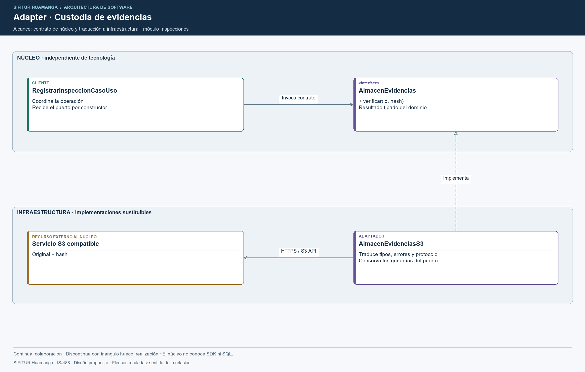
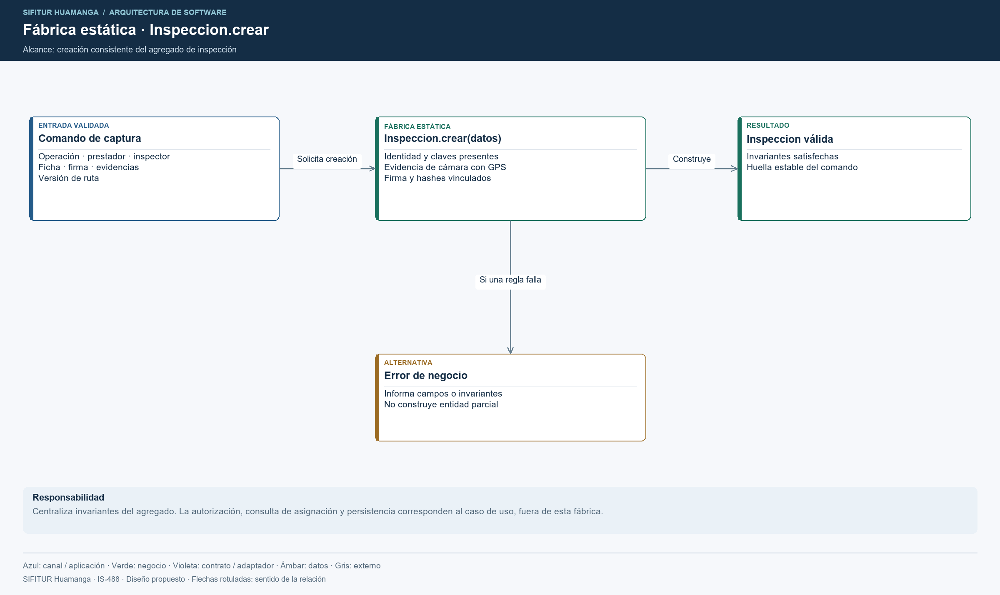
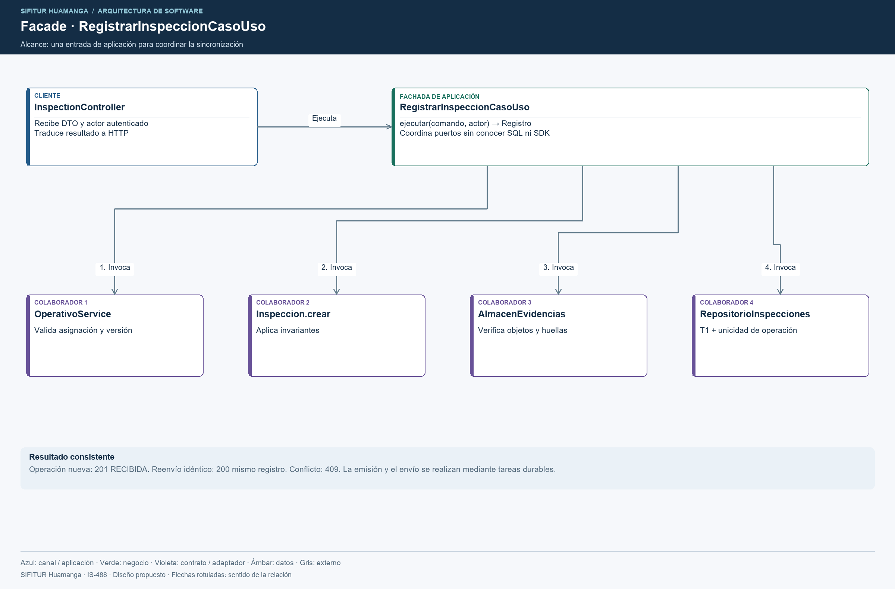
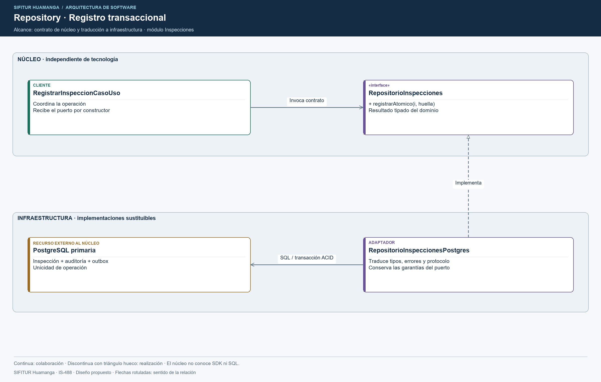

# Patrones de diseño

## Objetivo

Definir los patrones seleccionados para implementar el backend de SIFITUR Huamanga, su ubicación y el problema que resuelven.

## Contexto

- Estilo: backend monolítico modular Node.js/NestJS.
- Enfoque interno: Clean Architecture.
- Módulo de referencia: Inspecciones y custodia de evidencias.

## Patrones previstos en el diseño

| Patrón | Dónde se usa | Problema que resuelve | Implementación |
|---|---|---|---|
| Adapter | Evidencias → S3; padrón → SUNAT/MINCETUR; notificaciones → SMS/correo. | Formatos y mecanismos distintos de los proveedores. | Contratos internos y clientes de infraestructura. |
| Repository | Inspecciones, padrón y subsanaciones → PostgreSQL. | Evitar dependencia del negocio de SQL u ORM. | Repositorios PostgreSQL por módulo; dobles de prueba en memoria durante validación. |
| Fábrica estática | Creación de Inspeccion y Evidencia. | Evitar entidades incompletas o inválidas. | Inspeccion.crear(datos) y validación de Evidencia. |
| Facade | Entrada de sincronización de inspecciones. | Coordinar validación, evidencia y persistencia con una operación de aplicación. | RegistrarInspeccionCasoUso. |

## Diagramas de patrones

### Adapter: almacenamiento de evidencias

### Fábrica estática: creación de inspecciones

### Facade: sincronización

## Fuentes editables

- [Adapter](../../../img/fuentes-svg/patron-adapter.svg).
- [Factory](../../../img/fuentes-svg/patron-factory.svg).
- [Facade](../../../img/fuentes-svg/patron-facade.svg).

## Repository: persistencia de inspecciones

El repositorio ofrece registro atómico por identificador de operación, consulta y confirmación del acta. El adaptador PostgreSQL aplica unicidad y transacciones; dos solicitudes simultáneas no pueden crear dos inspecciones con la misma operación.

Fuente editable: [Repository](../../../img/fuentes-svg/patron-repository.svg).

## Alcance de los patrones

`Inspeccion.crear` es una fábrica estática para centralizar invariantes; no requiere una jerarquía Factory Method. `RegistrarInspeccionCasoUso` ofrece una fachada al flujo, pero conserva la autorización y las reglas en sus responsables.

La evaluación de riesgo utiliza una política configurable y versionada. La consulta pública administra la caché desde su servicio de aplicación. La generación del acta y la notificación se coordinan mediante tareas durables, outbox y consumidores del trabajador, según las secuencias del [nivel 4](../../04-modelo-c4/Nivel4-DiagramadeCodigo.md).
