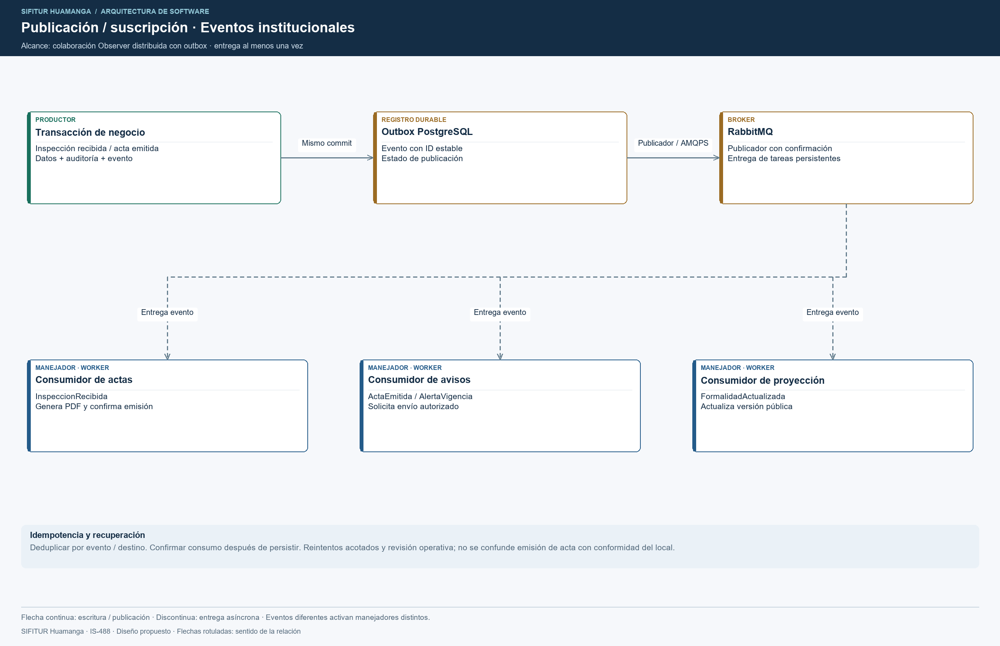
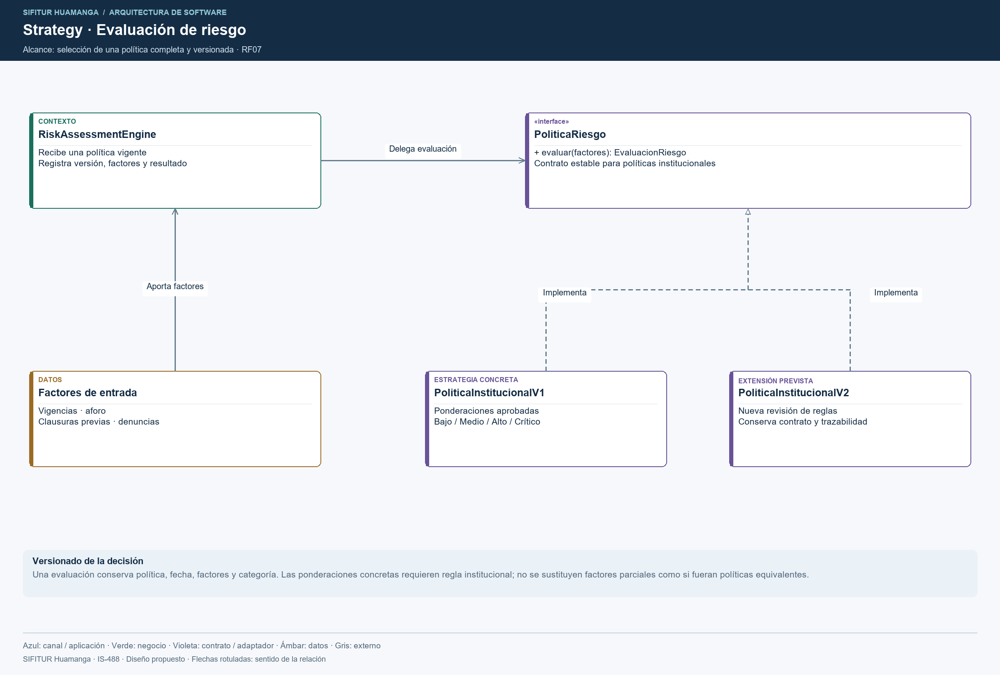
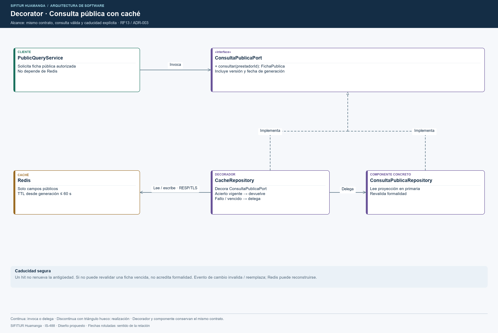

# Patrones de diseño

## Objetivo

Definir los patrones del backend de SIFITUR Huamanga, su ubicación y el problema que resuelven.

## Contexto

- Estilo: backend monolítico modular Node.js/NestJS.
- Enfoque interno: Clean Architecture.
- Módulo de referencia: Inspecciones y custodia de evidencias.

## Patrones previstos en el diseño

| Patrón | Dónde se usa | Problema que resuelve | Implementación |
|---|---|---|---|
| Adapter | Evidencias → S3; padrón → SUNAT/MINCETUR; notificaciones → SMS/correo. | Formatos y mecanismos distintos de los proveedores. | Contratos internos y clientes de infraestructura. |
| Repository | Inspecciones, padrón y subsanaciones → PostgreSQL. | Evitar dependencia del negocio de SQL u ORM. | Repositorios PostgreSQL por módulo; dobles de prueba en memoria durante validación. |
| Decorator | Consulta pública → caché Redis. | Acelerar QR y directorio sin cambiar el contrato de consulta. | CacheRepository y repositorio de consulta con invalidación por cambios. |
| Fábrica estática | Creación de Inspeccion y Evidencia. | Evitar entidades incompletas o inválidas. | Inspeccion.crear(datos) y validación de Evidencia. |
| Facade | Entrada de sincronización de inspecciones. | Coordinar validación, evidencia y persistencia con una operación de aplicación. | RegistrarInspeccionCasoUso. |

## Diagramas de patrones

### Adapter: almacenamiento de evidencias

### Fábrica estática: creación de inspecciones

### Facade: sincronización

## Patrones del procesamiento institucional

| Patrón | Dónde se utiliza | Colaboración |
|---|---|---|
| Publicación/suscripción (colaboración Observer) | ActaEmitida → notificación; FormalidadActualizada → proyección pública. | La realización distribuida usa outbox y RabbitMQ; entrega al menos una vez y deduplicación por evento. No es un Observer síncrono en memoria. |
| Strategy | Clasificación del riesgo. | RiskAssessmentEngine delega en políticas documentales, antecedentes y composición versionada. |

Las categorías de riesgo son Bajo, Medio, Alto y Crítico. Las ponderaciones se configuran mediante la política institucional; cada evaluación conserva la versión aplicada.

## Fuentes editables

- [Adapter](../../../img/fuentes-svg/patron-adapter.svg).
- [Factory](../../../img/fuentes-svg/patron-factory.svg).
- [Facade](../../../img/fuentes-svg/patron-facade.svg).
- [Observer](../../../img/fuentes-svg/patron-observer.svg).
- [Strategy](../../../img/fuentes-svg/patron-strategy.svg).

## Repository y Decorator

El repositorio ofrece registro atómico por identificador de operación, consulta y confirmación del acta. El adaptador PostgreSQL aplica unicidad y transacciones; dos solicitudes simultáneas no pueden crear dos inspecciones con la misma operación.

El decorador de caché y el repositorio de proyección implementan `ConsultaPublicaPort`. Un acierto solo se entrega si su versión y antigüedad son válidas; un fallo consulta la primaria y almacena el resultado con caducidad. Un error de Redis no cambia la política de autorización ni publica información privada.

Fuentes editables: [Repository](../../../img/fuentes-svg/patron-repository.svg) y [Decorator](../../../img/fuentes-svg/patron-decorator.svg).

## Alcance de los patrones

`Inspeccion.crear` es una fábrica estática para centralizar invariantes; no requiere una jerarquía Factory Method. `RegistrarInspeccionCasoUso` ofrece una fachada al flujo, pero conserva la autorización y las reglas en sus responsables. Strategy selecciona una política de riesgo completa y versionada; los factores documentales, aforo, denuncias y antecedentes son entradas de esa política, no estrategias intercambiables entre sí.
