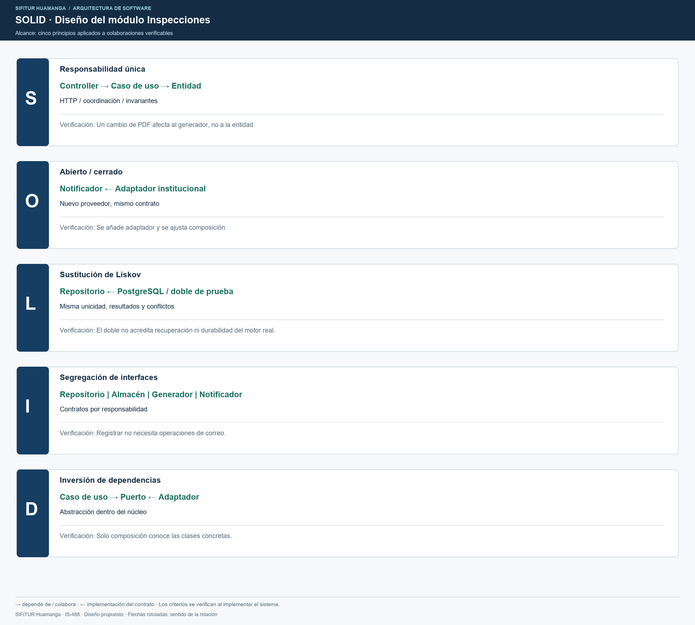
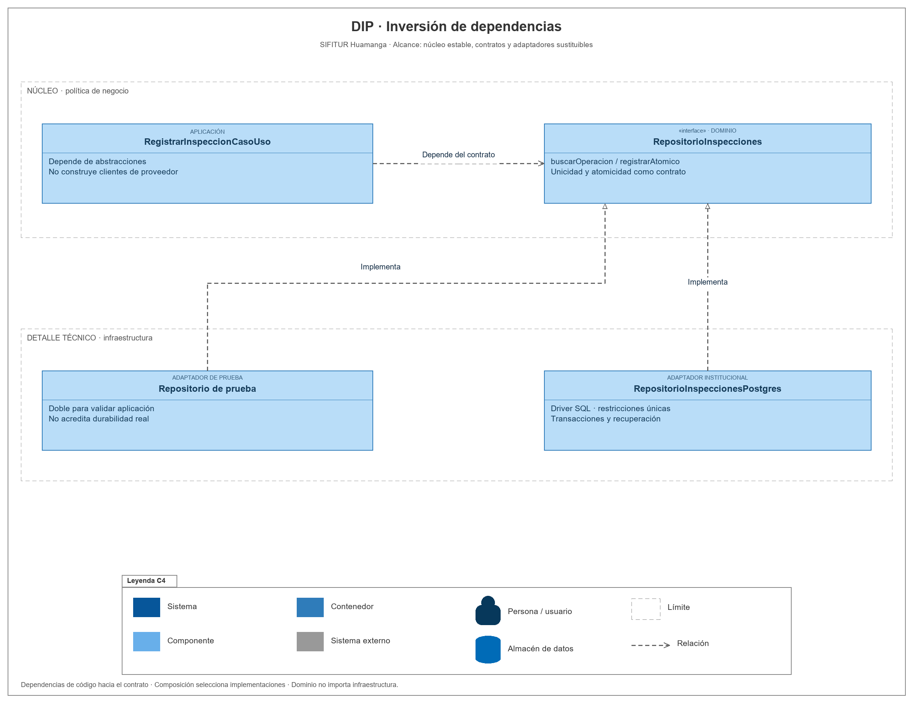

# Principios de diseño (SOLID)

## Objetivo

Organizar el módulo Inspecciones de SIFITUR Huamanga mediante clases con responsabilidades y contratos explícitos.

## SOLID en el módulo Inspecciones

| Principio | Dónde se aplica | Aplicación al proyecto | Archivos |
|---|---|---|---|
| S · Responsabilidad única | Todas las capas. | El controlador traduce HTTP; la entidad valida; el caso de uso coordina; el generador produce PDF. | inspection.controller.ts, inspeccion.ts, registrar-inspeccion.caso-uso.ts, generador-actas-pdf.ts |
| O · Abierto/cerrado | Infraestructura. | Un nuevo proveedor de objetos o correo se agrega mediante otro adaptador. | contratos.ts, almacen-s3.ts, notificador-institucional.ts |
| L · Sustitución de Liskov | Contratos. | Memoria y PostgreSQL mantienen el mismo resultado, idempotencia y conflictos; los almacenes verifican la misma integridad. | contratos.ts, repositorio-postgres.ts |
| I · Segregación de interfaces | Dominio. | Persistir, custodiar objetos, generar PDF y notificar tienen contratos separados. | RepositorioInspecciones, AlmacenEvidencias, GeneradorActas, Notificador |
| D · Inversión de dependencias | Aplicación y composición. | Los casos de uso reciben interfaces; NestJS conecta las clases concretas en el módulo. | registrar-inspeccion.caso-uso.ts, procesar-acta.caso-uso.ts, inspecciones.module.ts |

## Inversión de dependencias

## Cambios y efecto esperado

| Cambio | Punto de modificación |
|---|---|
| Cambiar el motor del repositorio. | Adaptador del repositorio y composición. |
| Cambiar el proveedor de almacenamiento S3. | Adaptador AlmacenEvidencias y composición. |
| Cambiar correo por otro proveedor institucional. | Adaptador Notificador y composición. |
| Modificar una validación de evidencia. | Entidad Evidencia y sus pruebas. |
| Cambiar la política de riesgo. | Estrategia versionada del módulo Riesgo. |

## Verificación

La verificación del diseño contempla pruebas de dominio y aplicación sin NestJS ni conexión a servicios externos, incluyendo validaciones, reenvíos idempotentes, conflictos, integridad de objetos y recuperación de notificaciones.

Fuentes editables: [SOLID](../../../img/fuentes-svg/solid-modulo-inspecciones.svg) y [DIP](../../../img/fuentes-svg/principio-dip.svg).

## Criterios de sustitución y dependencia

| Principio | Comprobación prevista |
|---|---|
| SRP | Cambiar el formato del PDF modifica GeneradorActasPdf, sin introducir renderizado en Inspeccion ni en el controlador. |
| OCP | Añadir un proveedor de notificaciones requiere otro adaptador y composición; mantiene el contrato Notificador. |
| LSP | Cualquier repositorio conserva unicidad, conflictos y atomicidad del contrato; un doble en memoria no demuestra durabilidad real de PostgreSQL. |
| ISP | RegistrarInspeccionCasoUso depende de repositorio y almacén; no necesita operaciones de correo. El consumidor de notificaciones solo necesita su contrato de envío. |
| DIP | Importaciones del dominio y aplicación sin NestJS, SQL, SDK ni clases de infraestructura; solo composición conoce implementaciones. |

Los nombres de archivos de este documento corresponden a la estructura prevista del diseño. La verificación ejecutable se realizará cuando se implemente el sistema.
