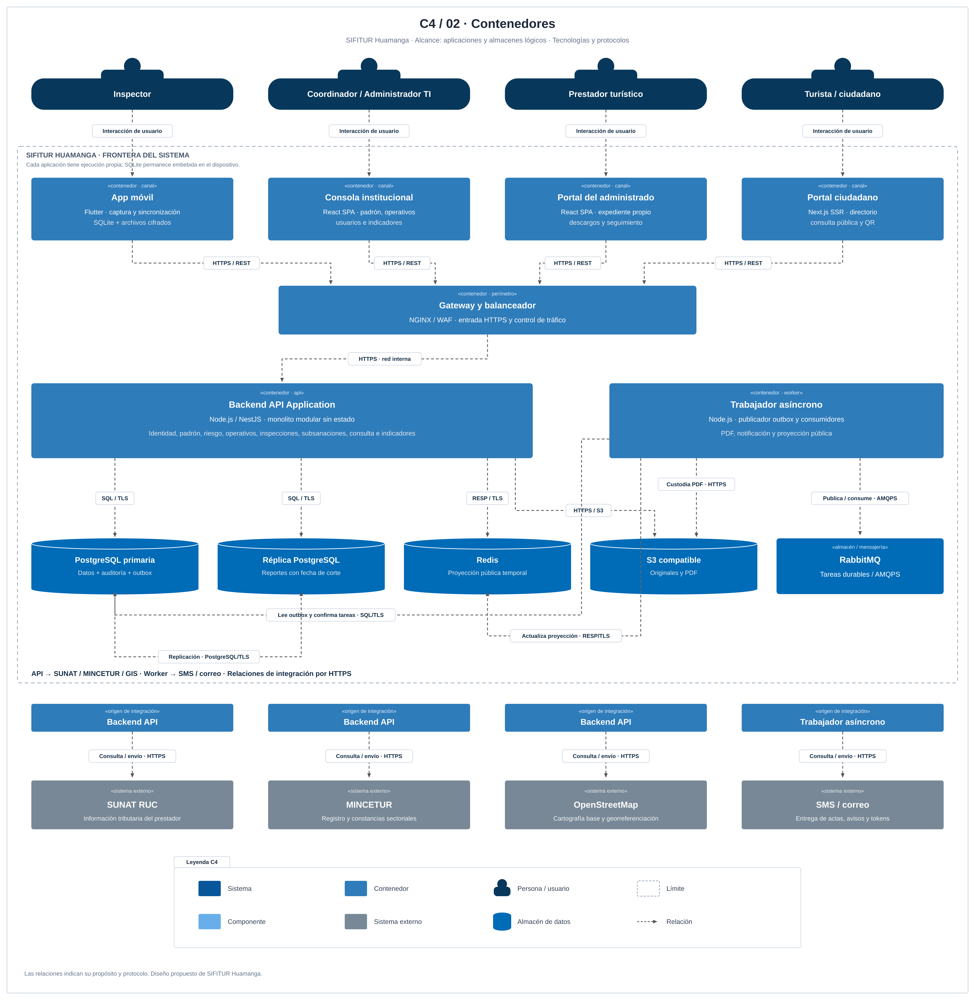

# Nivel 2 · Diagrama de contenedores

> **Proyecto:** SIFITUR Huamanga · **Modelo:** C4 · Nivel 2

## 1. Objetivo

Descomponer SIFITUR en aplicaciones ejecutables y almacenes de datos, indicando tecnologías, responsabilidades y protocolos. Audiencia: arquitectos, desarrolladores y operaciones.

## 2. Diagrama

Fuente editable: [nivel2-contenedores.svg](../../img/fuentes-svg/nivel2-contenedores.svg).

## 3. Contenedores

| Contenedor | Tecnología | Responsabilidad | Datos |
|---|---|---|---|
| App móvil | Flutter | Captura offline de inspecciones, firmas y fotografías. | Borradores y referencias locales. |
| Almacén local móvil | SQLite cifrada, embebida en Flutter | Retención segura y cola de sincronización. | Actas y evidencias pendientes. |
| Consola administrativa | React SPA | Padrón, usuarios, operativos, riesgo y evaluación. | Estado de interfaz. |
| Portal del administrado | React SPA | Expediente y descargos propios. | Estado de interfaz. |
| Portal ciudadano | Next.js SSR | Directorio y resolución QR pública. | Proyecciones autorizadas. |
| API Gateway / balanceador | NGINX + ModSecurity | TLS, filtrado y reparto de carga. | Configuración perimetral. |
| Backend API Application | Node.js/NestJS | Módulos, REST, JWT, RBAC y casos de uso. | Sin estado de sesión por instancia. |
| PostgreSQL primaria | PostgreSQL 16 | Transacciones, auditoría y outbox. | Información institucional. |
| PostgreSQL réplica | PostgreSQL 16 | Reportes y lectura tolerante al desfase. | Réplica de datos. |
| Caché | Redis 7 | Aceleración del directorio y QR. | Copias temporales de fichas públicas. |
| Objetos | S3 compatible | Custodia de originales y PDF. | Fotos, firmas y actas. |
| Cola | RabbitMQ | Entrega durable de trabajos. | Mensajes de tareas. |
| Trabajador | Node.js | Generación de actas, proyecciones y notificaciones. | Estado persistido en PostgreSQL. |

## 4. Relaciones

| Origen | Destino | Uso | Protocolo |
|---|---|---|---|
| Inspector | App móvil | Captura y sincronización. | Interacción local |
| Coordinador / TI | Consola | Gestión institucional. | HTTPS |
| Prestador | Portal del administrado | Consulta y descargos. | HTTPS |
| Ciudadano | Portal ciudadano | Verificación de formalidad. | HTTPS |
| Apps y portales | Gateway → API | Operaciones privadas y consultas públicas. | HTTPS/REST; red interna protegida |
| API | Primaria / réplica | Escrituras / reportes. | SQL sobre TCP 5432 |
| API | Redis | Consulta de proyección pública. | RESP sobre TLS; puerto configurado |
| API / trabajador | S3 | Verificar evidencia / guardar PDF. | HTTPS/S3 API |
| Publicador outbox del trabajador | RabbitMQ | Publicar tareas confirmadas. | AMQPS / TLS 5671 |
| Trabajador | RabbitMQ | Suscribirse, consumir y confirmar tareas. | AMQPS / TLS 5671 |
| API | SUNAT / MINCETUR / GIS | Consultas institucionales y cartografía. | HTTPS |
| Trabajador | Pasarela SMS / correo | Remitir actas y avisos. | HTTPS |
| Primaria | Réplica | Replicación. | Protocolo PostgreSQL |

## 5. Decisiones arquitectónicas

| Decisión | Motivo |
|---|---|
| Backend modular replicable | Mantener límites de negocio y escalar por demanda sin dividir cada módulo en servicio. |
| Caché de proyección pública | Optimizar el patrón de 95 % lecturas; invalidar cuando cambia formalidad. |
| Objetos separados del cómputo | Preservar evidencias al sustituir una instancia de aplicación. |
| Outbox y trabajador | Evitar pérdida de tareas entre confirmación del expediente y publicación en la cola. |
| Sincronización por operación única | Evitar duplicados al reenviar desde un dispositivo sin conexión. |

## 6. Seguridad entre contenedores

Las rutas privadas verifican JWT, rol y pertenencia. El portal público no exige sesión. Bases, objetos y mensajería se acceden mediante credenciales del servidor; no se distribuyen a los clientes. Los datos en reposo se cifran y las conexiones de despliegue se protegen con TLS.

Anterior: [Contexto](Nivel1-DiagramadeContextodelSistema.md). Siguiente: [Componentes](Nivel3-Diagrama-de-Componentes.md).

## 7. Relaciones de procesamiento y almacenamiento

| Origen | Destino | Interacción |
|---|---|---|
| App Flutter | SQLite y archivos locales cifrados | Conserva ficha, firma, metadatos y originales; almacenamiento embebido en el dispositivo. |
| Trabajador | PostgreSQL primaria | Lee outbox, confirma emisión y registra resultados de tareas; SQL sobre TLS. |
| Trabajador | Redis | Invalida o reemplaza proyecciones públicas versionadas; RESP sobre TLS. |
| Trabajador | S3 | Lee originales autorizados y guarda PDF y hash; HTTPS/S3 API. |
| Trabajador | RabbitMQ | Publica con confirmación y consume con acuse posterior a persistencia; AMQPS. |

El diagrama representa responsabilidades lógicas. El standby síncrono, réplicas físicas del broker, instancias API y dominios de fallo se detallan en el [HLD](../02-arquitectura-software/arquitectura-inicial.md); no constituyen nuevos módulos de negocio. SQLite es almacenamiento local embebido y no un servidor al que se conecte el backend.
