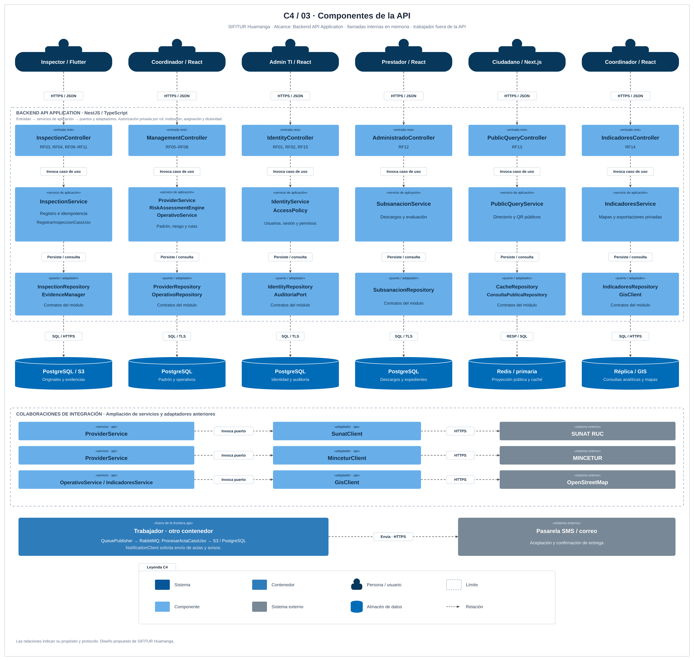

# Nivel 3 · Diagrama de componentes

> **Proyecto:** SIFITUR Huamanga · **Contenedor detallado:** Backend API Application · **Tecnología:** NestJS / TypeScript

## 1. Objetivo

Descomponer la API en entradas, servicios de aplicación y adaptadores. Esta vista sirve a arquitectos y desarrolladores; las llamadas dentro de la frontera son en memoria. El trabajador, los almacenes y los sistemas externos permanecen fuera de esa frontera.

## 2. Diagrama

Fuente editable: [nivel3-componentes.svg](../../img/fuentes-svg/nivel3-componentes.svg).

## 3. Componentes

| Componente / módulo | Responsabilidad | Requisitos |
|---|---|---|
| IdentityController / IdentityService | Inicio y recuperación de sesión; gestión de usuarios y roles. | RF01, RF02, RF15 |
| Auth & RBAC Guard / AccessPolicy | Validar identidad, institución, asignación y titularidad. | RF01, RF02, RF03 |
| InspectionController / InspectionService | Recibir captura, consultar operación y coordinar RegistrarInspeccionCasoUso. | RF03, RF09–RF11 |
| FileValidator / InspectionValidator | Validar formato, metadatos y consistencia del comando. | RF09, RF10 |
| ManagementController / ProviderService | Gestionar padrón, documentos, vigencias y validaciones pendientes. | RF05, RF06 |
| RiskAssessmentEngine | Aplicar política versionada a vigencias, aforo, antecedentes y denuncias registradas. | RF07 |
| OperativoService | Campañas, polígonos, asignaciones y versiones de rutas. | RF08 |
| AdministradoController / SubsanacionService | Consultar expediente propio, recibir descargo y registrar evaluación autorizada. | RF12 |
| PublicQueryController / PublicQueryService | Entregar directorio y QR públicos, con fecha y versión de formalidad. | RF13 |
| IndicadoresController / IndicadoresService | Tableros, mapas y exportación privada por periodo y distrito. | RF14 |
| InspectionRepository / AuditoriaPort | Confirmar inspección, auditoría y outbox en la misma transacción. | RF04, RF09, RF11 |
| ProviderRepository / OperativoRepository / SubsanacionRepository | Persistencia bajo propiedad de su módulo. | RF05, RF06, RF08, RF12 |
| CacheRepository / ConsultaPublicaRepository | Consulta decorada con caché y verificación de antigüedad. | RF13 |
| IndicadoresRepository | Proyecciones autorizadas de lectura para reportes. | RF14 |
| EvidenceManager / StorageAdapter | Comprobar originales y hashes; registrar referencias custodiadas. | RF10, RF11 |
| SunatClient / MinceturClient / GisClient | Traducir contratos internos a protocolos de terceros. | RF05, RF06, RF08, RF14 |

## 4. Relaciones entre componentes

| Origen | Destino | Colaboración |
|---|---|---|
| Entradas privadas | Auth & RBAC Guard → AccessPolicy | Verificar sesión y ámbito antes del caso de uso. Login y recuperación son rutas acotadas sin sesión previa. |
| InspectionController | InspectionService | Valida DTO y llama RegistrarInspeccionCasoUso. |
| InspectionService | OperativoService | Comprueba que el inspector y la versión de ruta siguen autorizados. |
| InspectionService | EvidenceManager → StorageAdapter | Verifica existencia y huella de los objetos recibidos. |
| InspectionService | InspectionRepository + AuditoriaPort | Confirma registro, auditoría y outbox con unidad de trabajo. |
| ManagementController | ProviderService / RiskAssessmentEngine / OperativoService | Gestiona padrón, prioriza y asigna visitas. |
| ManagementController / AdministradoController | SubsanacionService | Evalúa institucionalmente / presenta descargo propio. |
| ProviderService | SunatClient / MinceturClient | Contrasta información y conserva estado de validación. |
| OperativoService / IndicadoresService | GisClient | Obtiene cartografía; el análisis territorial pertenece al módulo. |
| PublicQueryController | PublicQueryService → CacheRepository | Entrega únicamente la proyección pública vigente. |
| IndicadoresController | IndicadoresService → IndicadoresRepository | Consulta reportes autorizados; nunca expone la ruta privada como QR. |

## 5. Relaciones con otros contenedores

| Elemento | Destino | Protocolo / propósito |
|---|---|---|
| Repositorios de escritura | PostgreSQL primaria | SQL/TLS; transacciones de negocio, auditoría y outbox. |
| IndicadoresRepository | Réplica PostgreSQL | SQL/TLS; lecturas con fecha de corte. |
| CacheRepository | Redis | RESP/TLS; proyecciones públicas temporales. |
| StorageAdapter | S3 | HTTPS; originales y metadatos de custodia. |
| SunatClient / MinceturClient / GisClient | SUNAT / MINCETUR / OpenStreetMap | HTTPS; integración prevista con límites y tiempos de espera. |
| Trabajador (otro contenedor) | PostgreSQL / RabbitMQ / S3 / Redis | Publicador outbox, consumidores de actas y proyecciones; persistencia y confirmación de tareas. |
| NotificationClient (dentro del trabajador) | SMS / correo | HTTPS; entrega de actas, avisos y recuperación de acceso. |

`QueuePublisher`, `ProcesarActaCasoUso` y `NotificationClient` se ejecutan en el trabajador. La API escribe la tarea durable; no depende de que el broker o el correo estén disponibles para confirmar una recepción ya persistida.

## 6. Reglas del monolito modular

Cada módulo expone su API pública y posee sus tablas. Los módulos colaboran mediante contratos, sin acceder a repositorios privados de otro módulo. La unidad de trabajo coordina auditoría y outbox en las mutaciones sensibles. Las entidades no llaman a servicios externos; infraestructura implementa puertos del núcleo.

## 7. Trazabilidad entre niveles

| Elemento de contexto | Contenedor de acceso | Componente de entrada / integración |
|---|---|---|
| Inspector | App Flutter | InspectionController |
| Coordinador | Consola React | ManagementController / IndicadoresController |
| Administrador TI | Consola React | IdentityController / consulta autorizada de auditoría |
| Prestador | Portal del administrado React | AdministradoController |
| Ciudadano | Portal Next.js | PublicQueryController |
| SUNAT | Backend API | SunatClient |
| MINCETUR | Backend API | MinceturClient |
| OpenStreetMap | Backend API | GisClient |
| SMS / correo | Trabajador | NotificationClient |

Los componentes del módulo Inspecciones se amplían en el nivel 4. Referencia de notación y alcance: [componentes C4](https://c4model.com/diagrams/component) y [leyenda y relaciones C4](https://c4model.com/diagrams/notation).

Anterior: [Contenedores](Nivel2-DiagramadeContenedores.md). Siguiente: [Código](Nivel4-DiagramadeCodigo.md).
