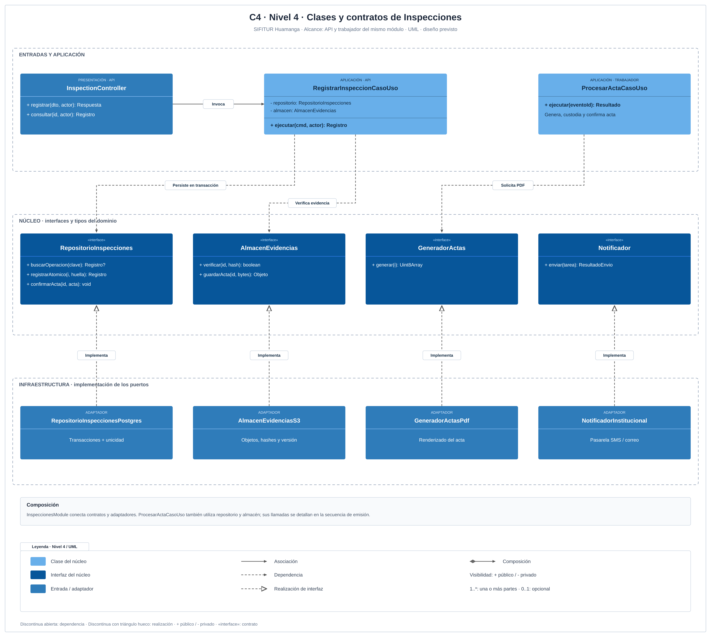
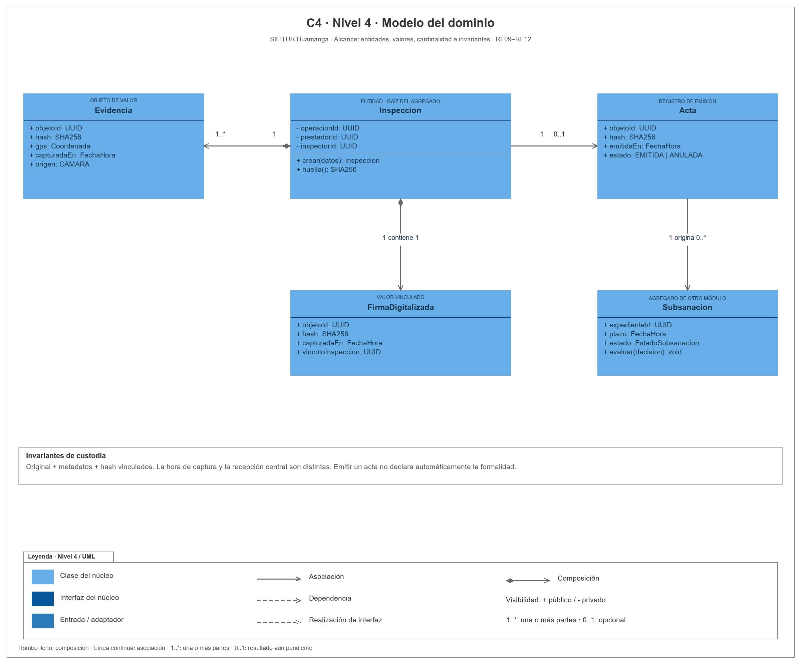
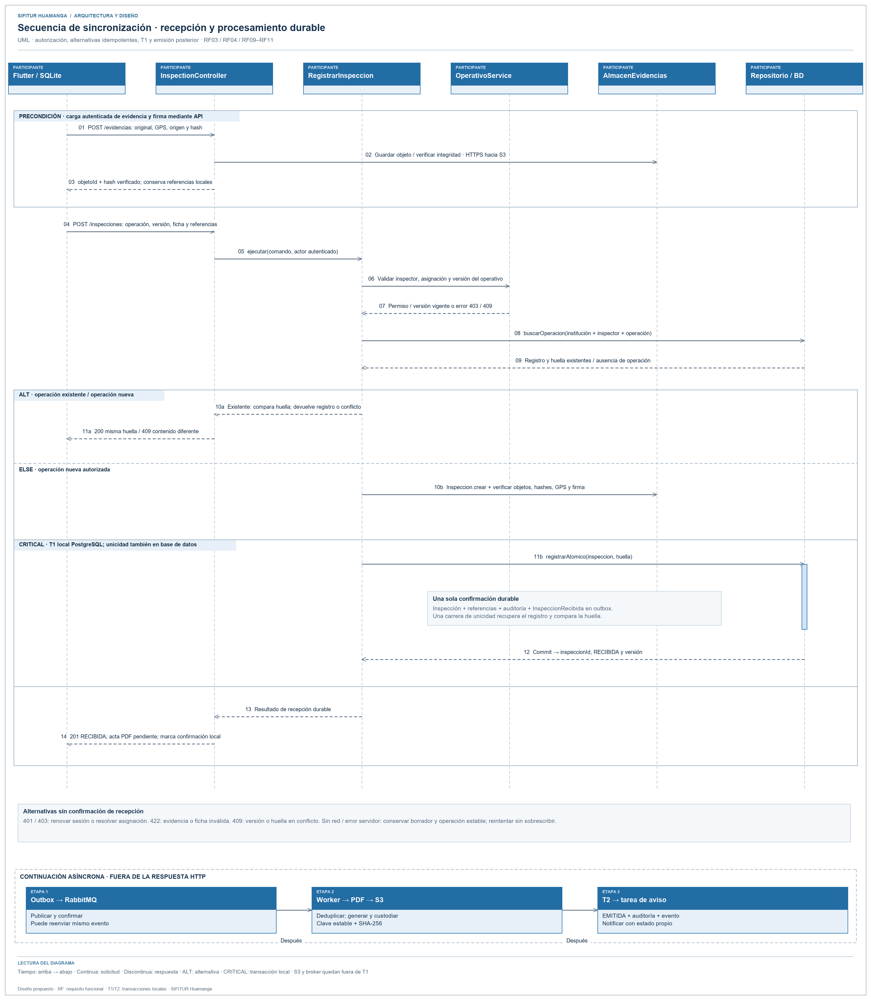
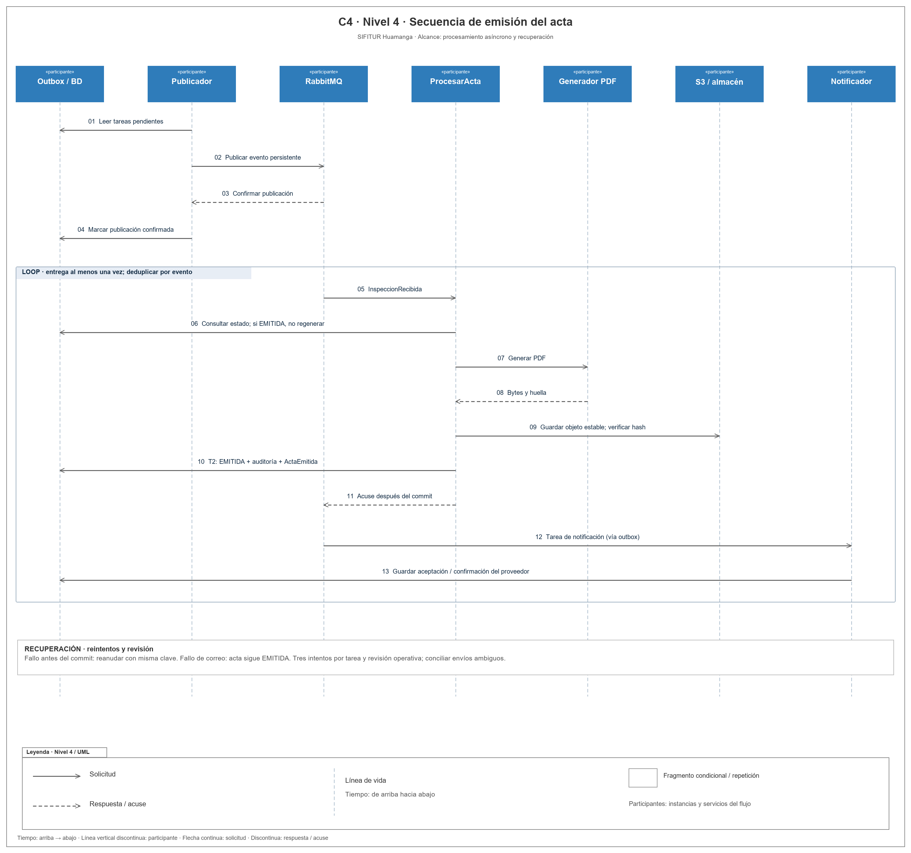

# Nivel 4 · Diagrama de código

> **Proyecto:** SIFITUR Huamanga · **Módulo:** Inspecciones · **Modelo:** C4 · Nivel 4 · **Notación:** UML

## 1. Objetivo

Detallar las clases y colaboraciones del flujo de sincronización de inspección y emisión del acta. Este flujo concentra RF09, RF10 y RF11, integridad, idempotencia y auditoría.

Esta vista descompone el componente Inspecciones del [nivel 3](Nivel3-Diagrama-de-Componentes.md) en clases, interfaces y objetos del dominio. Incluye cuatro diagramas: clases y contratos, modelo del agregado, secuencia de registro y secuencia de emisión. La API recibe la inspección; el trabajador procesa su acta y la notificación posterior.

## 2. Diagrama de clases

Fuente editable: [nivel4-clases.svg](../../img/fuentes-svg/nivel4-clases.svg).

### 2.1 Capas

| Capa | Clases |
|---|---|
| Presentación | InspectionController. |
| Aplicación | RegistrarInspeccionCasoUso y ProcesarActaCasoUso. |
| Dominio | Inspeccion, Evidencia, Acta y contratos. |
| Infraestructura | RepositorioInspeccionesPostgres, AlmacenEvidenciasS3, GeneradorActasPdf y NotificadorInstitucional. |

### 2.2 Clases y contratos

| Elemento | Tipo | Responsabilidad |
|---|---|---|
| Inspeccion | Entidad | Datos de inspección, evidencias, firma y huella de operación. |
| Evidencia | Objeto de valor | Identificador de objeto, hash, GPS y origen cámara. |
| Acta | Valor de resultado | Referencia al PDF, hash y estado emitida. |
| RegistrarInspeccionCasoUso | Caso de uso | Verificar actor, reenvío y objetos antes de registrar. |
| ProcesarActaCasoUso | Caso de uso | Emitir PDF y conservar tarea de notificación. |
| RepositorioInspecciones | Interfaz | Confirmar inspección, auditoría y outbox; buscar duplicados. |
| AlmacenEvidencias | Interfaz | Verificar hashes de objetos y guardar PDF. |
| GeneradorActas | Interfaz | Producir bytes PDF a partir de una inspección. |
| Notificador | Interfaz | Remitir la copia del acta al destinatario autorizado. |
| InspectionController | Controlador | Traducir entrada REST y resultado HTTP. |

### 2.3 Modelo del agregado

Fuente editable: [modelo del agregado](../../img/fuentes-svg/clases-modulo-inspecciones.svg).

### 2.4 Notación

Las clases muestran atributos y operaciones públicas (`+`) o privadas (`-`). `«interface»` identifica un contrato. La asociación usa línea continua con flecha abierta; la dependencia, línea discontinua con flecha abierta; la realización de interfaz, línea discontinua con triángulo hueco. El rombo lleno en Inspeccion indica composición de una o más Evidencia (`1..*`); Acta mantiene una asociación `0..1` mientras su emisión está pendiente. El [diagrama DIP](../../img/principio-dip.png) amplía las dependencias entre núcleo y adaptadores.

El azul claro identifica clases del núcleo; el azul oscuro, interfaces; y el azul medio, entradas y adaptadores. Los límites discontinuos agrupan responsabilidades. Cada figura incluye su leyenda UML; el color complementa el tipo declarado dentro de cada elemento.

## 3. Diagramas de secuencia

### 3.1 Registro y sincronización de inspección

Fuente editable: [secuencia de registro](../../img/fuentes-svg/secuencia-registrar-inspeccion.svg).

`InspectionController` delega en `RegistrarInspeccionCasoUso`. El caso de uso verifica asignación, operación y evidencias mediante los contratos del núcleo. La transacción T1 conserva inspección, auditoría y evento outbox antes de responder `201 RECIBIDA`; el PDF todavía puede estar pendiente. Un reenvío idéntico obtiene el registro existente con `200`; una huella distinta para la misma operación produce `409`.

Las precondiciones, autorizaciones y alternativas de error se especifican en el [flujo de sincronización](../03-diseño-de-software/diseño-interno/diseño-interno-de-modulos.md#6-flujo-sincronizar-inspección).

### 3.2 Emisión asíncrona del acta y notificación

Fuente editable: [nivel4-secuencia.svg](../../img/fuentes-svg/nivel4-secuencia.svg).

La secuencia desarrolla la emisión asíncrona desde una inspección ya recibida. `ProcesarActa` representa a `ProcesarActaCasoUso`; `Generador PDF` y `S3 / almacén` representan colaboradores accesibles mediante `GeneradorActas` y `AlmacenEvidencias`. `Outbox / BD` resume la persistencia transaccional a través del repositorio. El participante `Notificador` resume el consumidor de avisos y su adaptador de envío.

| Fase | Acción y garantía |
|---|---|
| Publicación | Outbox contiene InspeccionRecibida; QueuePublisher publica y marca entrega solo tras confirmación del broker. |
| Consumo | El trabajador obtiene la tarea y comprueba si el acta ya fue emitida; un duplicado termina sin otra emisión. |
| Generación | GeneradorActas produce PDF; AlmacenEvidencias conserva objeto y hash con identificador estable. |
| Confirmación | Repositorio confirma EMITIDA, auditoría y ActaEmitida en T2; el consumidor acusa procesamiento después del commit. |
| Notificación | Otro consumidor remite la copia y guarda aceptación del proveedor; la entrega final requiere confirmación verificable. |
| Recuperación | Error transitorio: reintento; tras tres intentos: revisión. El acta emitida permanece disponible aunque falle correo. |

La emisión no cambia por sí sola el estado de formalidad del establecimiento. Las proyecciones públicas solo se actualizan a partir de cambios de formalidad autorizados.

## 4. Patrones y principios

| Elemento | Patrón / principio |
|---|---|
| Contratos y adaptadores | Adapter, Repository y DIP. |
| Inspeccion.crear | Fábrica estática y validación centralizada. |
| Entrada de sincronización | Facade de aplicación. |
| Controlador, entidad, generador y notificador separados | Responsabilidad única y segregación de interfaces. |

## 5. Frontera entre ejecución y contratos

`RegistrarInspeccionCasoUso` se ejecuta desde la API. `ProcesarActaCasoUso` se ejecuta desde el trabajador; ambos pertenecen al diseño del módulo Inspecciones y usan los mismos contratos de núcleo. `GeneradorActasPdf`, `AlmacenEvidenciasS3`, `RepositorioInspeccionesPostgres` y `NotificadorInstitucional` son adaptadores previstos, no evidencia de una implementación desplegada.

Los estados de captura, emisión, notificación y subsanación son independientes y se especifican en [estados y transacciones](../03-diseño-de-software/diseño-interno/diseño-interno-de-modulos.md#9-estados-y-transacciones).

Anterior: [Nivel 3 · Componentes](Nivel3-Diagrama-de-Componentes.md).
